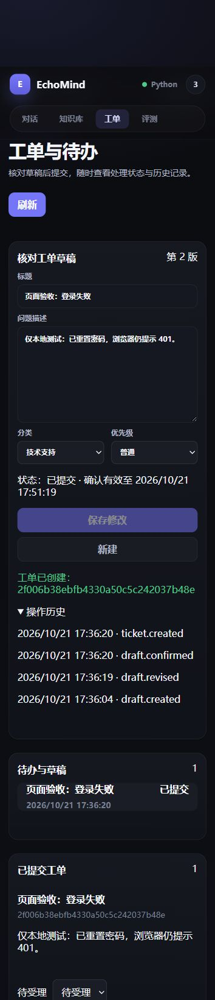
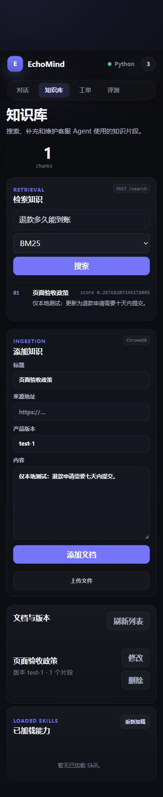

# Python 纯链路：验证记录

日期：2026-10-21。编排为现有 Python Orchestrator，没有引入 LangGraph、Dify、Coze。

## 自动回归

- Python 应用测试 + benchmark_v1 测试：**206 passed**。
- 前端 Node 协议与流式测试：**12 passed**。
- 前端 `npm run build`：通过，Vite 7.3.5。
- Python 测试有一条现有 Starlette/anyio 兼容弃用警告，不影响通过。
- 两份 Compose 文件已通过 YAML 解析，业务挂载与 readiness 路径检查通过；这不替代 Docker 实际启动。

执行环境：Python 3.12.7，现有测试依赖通过 `PYTHONPATH=D:\EchoMind\.test-runtime;D:\EchoMind\EchoMind` 加载。pytest 临时目录使用工作区下 `.test-runs`，避开受限系统临时目录。

```powershell
$env:PYTHONPATH = 'D:\EchoMind\.test-runtime;D:\EchoMind\EchoMind'
python -m pytest tests evaluation/benchmark_v1/tests -q -p no:cacheprovider --basetemp D:\EchoMind\.test-runs\<新的测试目录>
```

关键测试：

| 文件 | 覆盖 |
|---|---|
| `tests/test_business_store.py` | 草稿重启、并发确认唯一工单、旧批准失效、取消/拒绝/过期、同键异参、组织/角色权限、状态版本、会话归属、事务回滚、SQLite 在线备份恢复 |
| `tests/test_knowledge_lifecycle.py` | 三种召回过滤、稳定身份与内容版本、旧片段清理、发布失败恢复/隔离、显式旧元数据迁移、分块长度 |
| `tests/test_tool_manager_contracts.py` | 重排真实状态、无效排序、部分失败、降级、空命中、跨身份缓存与版本失效 |
| `tests/test_operations_api.py` | Cookie 登录/注销、Origin、角色、确认契约、组织知识隔离、产品版本/知识库过滤交集、依赖就绪、服务端身份、评测范围/基线隔离 |
| `tests/test_evaluator.py` | Judge 失败无假分、历史/参考事实/证据、覆盖率、不可变报告与可比基线 |
| 前端 `tests/operations.test.js` | 精确提交保存版本、409 错误、Cookie、检索策略、来源/草稿/警告保留 |

## 页面验收

用临时 SQLite 业务文件和假模型/假 Chroma 启动隔离后端，经 Vite 同源代理访问。页面验收通过：

1. 测试账号登录，创建草稿时已提交工单数为 0。
2. 修改正文后“确认提交”禁用；保存第 2 版后可确认。
3. 确认后显示工单编号、待受理状态和创建/修改/确认审计。
4. 添加文档、编辑替换正文，再用 BM25 检索得到更新后的正文，片段总数仍为 1。
5. 浏览器未记录前端 JavaScript 错误。测试服务已停止；没有把临时账号或业务库放入正式数据目录。

页面截图均为窄视口的本地测试数据：





## 证据边界

真实文件事务与恢复测试证明本机 SQLite 逻辑；Chroma 适配器与模型采用测试替身。未运行真实 Redis/Chroma 检索质量测试、付费模型、云端部署、Docker 重建或性能压测。当前机器没有可用 Docker 命令。部署配置已更新，仍需在实际部署环境验收。

benchmark_v1 的 276 条候选仍待人工复核，未自动导入应用；future contract 未伪报为全部已测。逐主张忠实性、引用支持、真实效果与成本不能从上述通过数推导。
