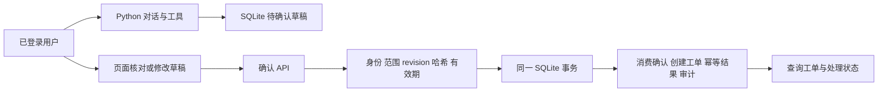

# EchoMind：Python 纯链路实施与验收

更新：2026-10-21。对应《项目改进说明书》的第一轮功能落实。编排继续使用现有 Python Orchestrator、asyncio 与工具函数，前端继续使用 Vue。没有新增 Agent 开发框架。

## 1. 本轮实际实现

| 范围 | 行为与代码 | 验证方式 |
|---|---|---|
| 工单闭环 | `business/store.py` 保存草稿、确认、工单、幂等结果与审计；`api/operations.py` 提供独立接口 | 真实 SQLite 文件测试，覆盖并发提交、事务回滚、重启读取与备份恢复 |
| 人工确认 | 模型只有创建草稿、查询工单的工具；提交只能经过确认 API | 版本与内容哈希校验；修改后旧确认失效；拒绝、取消、过期均阻止提交 |
| 身份与隔离 | 本地账号、PBKDF2 密码、哈希会话令牌、HttpOnly Cookie / Bearer；组织与角色由服务端读取 | 跨组织、同组织其他普通用户、伪造角色、注销、过期、来源校验测试 |
| 知识生命周期 | 稳定文档/片段 ID、内容版本、来源、产品版本；更新替换旧片段，删除使缓存失效 | 假 Chroma 适配器验证元数据、更新/删除、发布失败回滚与隔离 |
| 检索 | vector / BM25 / hybrid（RRF）；产品版本、知识库筛选与组织范围求交；按稳定片段 ID 去重 | 检索策略、过滤交集、缓存范围、缓存版本、失败与重排状态测试 |
| 证据返回 | `/chat` 与流式最终结果返回实际检索片段、待确认任务、降级提示 | API 与前端响应协议测试；页面可展开来源 |
| 评测留档 | 每次运行独立 run_id 与 JSON；Judge 失败无假分数；显式晋升基线，按组织隔离 | 用例/配置指纹可比检查；报告读取和组织范围测试 |
| 前端 | 登录、草稿编辑与确认、取消、工单状态、审计、知识更新/删除、历史报告与基线选择 | Node 请求协议测试和 Vite 构建；页面人工验收见后文 |
| 运行配置 | 业务数据库挂载、依赖就绪检查、关闭静默切换本地 Chroma、备份/验证 CLI | 配置审查及 SQLite 恢复测试；本轮未实际运行 Docker/云端服务 |

知识库默认仍只有内置演示文档。此前构建的 benchmark_v1 包含 36 篇合成资料和 276 条候选用例，**没有自动写入运行库**，所有样本仍待人工复核。本轮没有虚构扩容数据、线上指标或付费模型评测成绩。

## 2. 业务流程与事务边界



草稿状态为 `waiting_confirmation → completed / cancelled / rejected / expired`。工单为 `open → in_progress → resolved → closed`，处理中允许取消，已解决允许重新处理。支持人员与管理员才能变更工单状态，使用 `version` 防止覆盖并发修改。

确认请求必须提交当前 `revision`、`payload_hash` 和 `idempotency_key`。前端使用服务端保存的值，不以修改中的表单代替。草稿修改会增加版本、生成新哈希并撤销旧确认。相同操作重复请求返回原结果，同键不同内容返回 409。SQLite 的事务同时提交工单、确认消费和审计；提交后响应丢失也可以用原键重试获取同一工单。

模型不能调用确认接口；提示词声明“已提交”不能改变数据库。草稿和工单详情以 API 查询结果为准。聊天超时不会自动提交工单，已经落库的草稿可从工单页面查询。

目前没有接入外部企业工单或资金系统。确认后的“真实工单”指本应用自建 SQLite 业务记录。

## 3. 启动、账号与权限

从 Python 仓库复制 `.env.example`，填写服务商提供的模型标识与密钥、Redis 配置。现有 `.env` 不应覆盖或提交。服务启动后默认要求登录，健康检查和内部抓取指标入口可免登录。

后端与前端一起部署，先在 `EchoMindFrontend` 目录复制其 `.env.example` 为 `.env`，将 Redis 密码设为与 Python 配置一致，保留需要的宿主机端口。启动时显式加载两个文件，前端配置最后加载以保留端口设置：

```bash
docker compose --env-file ../EchoMind/.env --env-file .env up -d --build
```

业务路径为 `/app/data/business/echomind.sqlite3`，已挂载到宿主机 `EchoMind/data/business`。评测报告在 `data/eval/reports`，每个组织的基线在 `data/eval/baseline-org-*.json`。保留现有 Redis 和 Chroma 数据卷。

首次开通管理员（容器需已运行；密码由终端隐式输入，至少 12 字符）：

```bash
docker compose exec echomind python -m business.auth --db /app/data/business/echomind.sqlite3 create-user --email admin@example.invalid --organization-name Demo
```

保存输出中的 `organization_id`。同一组织开通普通用户或客服：

```bash
docker compose exec echomind python -m business.auth --db /app/data/business/echomind.sqlite3 create-user --email customer@example.invalid --organization-id <组织ID> --role customer
docker compose exec echomind python -m business.auth --db /app/data/business/echomind.sqlite3 create-user --email support@example.invalid --organization-id <组织ID> --role support
```

本机运行也可以在 Python 仓库执行 `python -m business.auth --db data/business/echomind.sqlite3 ...`，必须使用与 API 完全相同的数据库路径。账号仅由可信本地命令开通，没有公开注册或默认密码。

| 角色 | 权限 |
|---|---|
| customer | 对话、检索公共与本组织资料、管理自己的草稿和查询自己的工单 |
| support | 同组织工单/任务与审计处理，工单状态更新 |
| kb_admin | 普通知识读取与本组织文档管理；自己的工单 |
| admin | 同组织工单管理、知识管理、评测/基线、运行监控 |

`user_id` 请求正文不再决定身份。对话 ID 与组织、所有者绑定；工作记忆按组织和用户命名空间保存。支持人员/管理员在同组织有服务处理权限。Trace 也检查请求归属。

浏览器使用 HttpOnly、SameSite=Lax Cookie，前端不将会话令牌放入 localStorage。生产 HTTPS 配置 `ECHOMIND_SECURE_COOKIES=true`，并将真实站点 origin（协议、主机、端口）加入 `ECHOMIND_CORS_ORIGINS`。代理保留 Host 端口；变更请求检查 Origin。命令行登录可传 `transport=bearer`，后续使用 `Authorization: Bearer ...`。登录限流是单进程的每 IP 十次/分钟；不是分布式网关限流。

`ECHOMIND_AUTH_REQUIRED=false` 仅供明确选择的旧版本地调试，不能作为正常部署配置；其匿名公共知识写入和正文身份兼容行为不适合作为隔离验收结果。

## 4. API 与手工验收

| 接口 | 作用 |
|---|---|
| POST `/auth/login`、GET `/auth/me`、POST `/auth/logout` | 登录、当前身份、注销 |
| POST/GET `/tasks` | 保存草稿、列出有权限任务 |
| GET `/tasks/{id}`、PUT `/tasks/{id}/draft` | 重启/刷新后读取、按 revision 修改 |
| POST `/tasks/{id}/confirm` | 校验确认内容并原子提交 |
| POST `/tasks/{id}/cancel`、`/reject` | 结束未提交任务 |
| GET `/tickets`、GET/PATCH `/tickets/{id}` | 查询、按 version 更新状态 |
| GET `/tasks/{id}/events`、`/tickets/{id}/events` | 审计记录 |
| POST `/knowledge/add`、`/knowledge/upload` | JSON、TXT、Markdown 导入，最多 200 文档/批，文件 10 MiB |
| GET `/knowledge/documents`、GET/PUT/DELETE `/knowledge/documents/{id}` | 文档读取、更新替换与删除 |
| POST `/search?query=…&strategy=hybrid&rewrite=false` | 检索策略；结果包含 score_type 与实际执行状态 |
| POST `/eval/run`、GET `/eval/reports`、GET `/eval/reports/{id}` | 执行和读取不可覆盖的评测报告 |
| POST `/eval/reports/{id}/baseline` | 显式选择有效、完整覆盖报告作为基线 |
| GET `/health/live`、`/health/ready` | 进程存活、业务库/Redis/Chroma 就绪 |

建议保留一次演示记录：

1. 普通用户登录，发送“请创建工单，登录后出现 401”。查看待确认草稿；此时 `/tickets` 没有新工单。
2. 在工单页修改描述并保存，确认后得到编号；重复确认仍返回同一编号。
3. 保存另一份草稿，刷新页面、重启后端，再登录读取并确认；不要把模型中途生成断点恢复作为此功能。
4. 切换客服账号受理工单，查看状态版本与事件；跨组织账号读取应返回 404。
5. 管理员上传带来源与产品版本的知识，比较三种检索；更新旧文档后搜索不应残留旧片段，删除后不再命中。
6. 运行小批评测，记录 run_id；明确选择基线，重复相同版本可比较，改变用例或配置后显示不可比原因。

## 5. 知识发布与检索的边界

文档根据组织、知识库、来源/标题生成稳定身份；内容与元数据生成版本，片段 ID 同时绑定版本、位置和内容。文档更新按“暂存新片段 → 删除旧片段 → 发布新片段”执行。失败尝试恢复旧版；无法完整恢复或重启发现未完成暂存时，整篇文档退出检索，统计中列出隔离 ID。

发布使用一个 Python 实例内的 RLock，**不是 Chroma 跨进程事务**。本轮部署使用单个 Uvicorn worker，不要让多个应用实例或维护脚本同时修改集合。大规模导入、分页索引、跨实例发布清单、知识版本回滚与可恢复导入队列仍待实现。

旧集合缺少 `organization_id` 时不会自动成为公共知识。先备份 Chroma 数据、停止应用写入，再由有权限的维护人员决定是否公开：

```bash
python -m mcp.knowledge_admin stats
python -m mcp.knowledge_admin migrate-legacy --organization-id public
```

维护命令从 `CHROMA_HOST` / `CHROMA_PORT` 读取地址，不自动加载 `.env`；宿主机先导出相应环境变量。容器内运行时可使用一次性 `docker compose run --rm --no-deps echomind python -m mcp.knowledge_admin ...`，应确保正式应用已停止。迁移仅更新元数据，不重新生成嵌入。

对已隔离文档，备份后可运行 `delete-quarantined --document-id <隔离ID>` 清理并重新导入原文。普通文档删除使用鉴权 API。

权限范围由服务器注入，再与可选过滤条件求交集。BM25 在授权文档内统计词频；hybrid 对向量与关键词排名做 RRF。向量返回 `score=-distance`、`score_type=negative_distance` 和真实距离；分数不是概率，不存在跨策略统一的相似度阈值。

`/search` 可选 `product_version` 与 `knowledge_base_id`，前端也有对应筛选。它们不能扩大组织权限。筛选使用精确元数据值，不自动推断版本兼容关系；文档更新不会自动保留可回滚的历史正文。

缓存键包含查询、身份范围、模型、文档源版本。更新/删除使旧缓存不可复用。改写与重排返回 `skipped/succeeded/failed`，失败时不会声称“已重排”。检索故障是 `success=false`，与健康检索的空结果不同；部分召回失败有独立标记。当前默认嵌入仍是 Chroma 客户端配置，尚未验证其中文真实语料检索质量。

`sources` 是本次实际检索片段。页面展示来源不等于已完成逐条引用支持校验；“回答每个事实都由来源支持”和提示注入抵抗仍需要语义评测，不能仅凭提示词和返回证据宣称已解决。

## 6. 评测集与指标衔接

沿用 [测试数据集构建与评测指标](测试数据集构建与评测指标.md) 和 `evaluation/benchmark_v1`。意图重点看 Accuracy、Macro-F1 和逐类样本数；检索看 Hit@K、Recall@K、MRR、nDCG；回答看事实覆盖、忠实性、引用支持与澄清/拒答行为；业务看全部断言通过率与重复写入数。所有指标同时报告覆盖率、错误数、样本数和测试条件。

内置 `/eval/run` 本轮修复历史 context 传递、实际检索证据传给 Judge、失败不打假分、不可覆盖报告与显式基线。它仍是旧的综合报告口径：`total` 包含一个意图套件结果行和每轮对话结果，意图样本覆盖率在结果元数据中，不能误称为全量逐样本通过率。

LLM Judge 的 accuracy 等均是模型裁判分数；没有逐主张验证时 `faithfulness_evaluated=false`。基线比较同时检查数据版本、数据内容指纹、配置版本、配置指纹。修改 Prompt、检索配置、代码或知识语料时，应显式更新 `config_version`；当前指纹不自动覆盖整个仓库或 Chroma 外部数据。缺失成本/usage 不按零成本计算。

API 基准适配器已兼容新的稳定 document_id 与原有唯一标题映射。使用独立测试组织导入 `exports/knowledge_add.json`，仅导入 corpus 正文，不导入题目、qrels 或参考答案。认证模式下所有 API chat 用例共享登录主体，即使正文给不同 user_id 也不会切换账号；当前画像可能跨题影响结果。严格对话实验应使用隔离账号/清理后的专用记忆，或使用不接入用户记忆的内置 evaluator；不能把用户正文当身份隔离证据。

已有 48 条 future contract 候选仍是验收规格。SQLite 与 API 测试覆盖其中工单幂等、确认、隔离等部分场景，但未自动生成全套 contract 预测；租约、fencing、outbox、外部工单对账等没有实现，保持未测。

## 7. 备份与恢复

在线备份使用 SQLite backup API，包含已提交的 WAL 数据，目标已存在时拒绝覆盖：

```bash
python -m business.maintenance backup --db data/business/echomind.sqlite3 --destination data/backups/business-20261021.sqlite3
python -m business.maintenance verify --db data/backups/business-20261021.sqlite3
```

恢复时先停止应用写入，验证备份，再把备份复制到**新的数据库文件**，通过 `ECHOMIND_BUSINESS_DB_PATH` 指向新路径后启动；容器固定路径则在停止状态下先保留旧文件及对应 WAL/SHM，再部署已验证的新文件。不要把备份覆盖到仍运行的 SQLite 文件。恢复会恢复备份时刻的账号和会话；限制备份文件权限。

该命令只备份业务 SQLite。Redis、Chroma、知识原始材料、配置和评测报告分别备份；业务库恢复成功不证明向量索引和记忆恢复成功。需要在真实部署环境再执行整套恢复演练。

## 8. 自动验证与剩余工作

本轮本地验证（不调用外部模型/Redis/Chroma）：

```bash
python -m pytest tests evaluation/benchmark_v1/tests -q -p no:cacheprovider
```

前端：

```bash
node --test tests/*.test.js
npm run build
```

在当前受限 Windows 环境，使用现有 `D:\EchoMind\.test-runtime` 依赖并将 pytest 临时目录置于工作区；正常依赖齐备的开发机无需该路径。

验证成绩见随代码维护的 `docs/native-python-verification.md`。回归覆盖工程行为；假 Chroma 不代表真实向量质量，假模型不代表真实对话通过率。当前机器没有可用 Docker 命令，未执行容器重建、云部署、真实依赖性能/并发压测或模型效果验证。

后续优先事项：人工复核并扩充授权产品语料；真实依赖下小批检索/对话评测；部署与恢复演练；分页与导入任务；模型 usage/成本；逐主张引用校验。多实例队列和框架迁移等待实际需要，本轮不新增框架。
