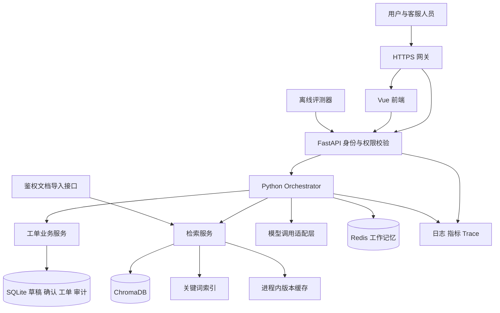

# EchoMind 项目改进说明书

> 编写日期：2026-10-21
>
> 文档版本：v1.1（补充 Python 实施约定）
>
> 定位：面向 Agent 应用研发与后端岗位的工程改进计划
>
> 主要改造对象：EchoMind Python 后端、现有 Vue 前端
>
> 当前实施约定：按用户最新要求保持原生 Python 编排，不引入 LangGraph、Dify、Coze。本轮先使用 SQLite 保存单机工单业务事实；PostgreSQL、分布式 worker 与外部平台均为后续规划。

> 实施记录与可运行命令：[Python 纯链路实施与验收](Python纯链路实施与验收.md)。下文原始差距表描述改造前快照；未在实施记录中验证的目标仍为规划，不能当作上线成果。

本文将 EchoMind 的后续改进拆成可以开发、测试、部署和展示的任务。目标是形成一条能够被实际验证的业务链路，并留下数据、评测、运行和故障处理证据。

本次编写基于仓库代码与官方文档的只读检查，没有启动服务、调用付费模型、检查实际知识库内容或核验云端资源。因此，文中的默认样本数量只代表仓库内置数据，不能代表实际运行库；部署文件只能证明已有配置，不能直接证明线上运行情况。本文本身不代表功能已完成。

## 目录

1. [改进目标与范围](#1-改进目标与范围)
2. [当前能力与主要差距](#2-当前能力与主要差距)
3. [目标架构与技术选择](#3-目标架构与技术选择)
4. [真实业务闭环：技术支持与工单](#4-真实业务闭环技术支持与工单)
5. [LangGraph 主链路改造](#5-langgraph-主链路改造)
6. [知识库数据建设与文档生命周期](#6-知识库数据建设与文档生命周期)
7. [检索链路与回答可信度优化](#7-检索链路与回答可信度优化)
8. [意图识别、上下文与记忆](#8-意图识别上下文与记忆)
9. [评测体系与指标定义](#9-评测体系与指标定义)
10. [身份认证、权限与数据隔离](#10-身份认证权限与数据隔离)
11. [前端与接口改造](#11-前端与接口改造)
12. [部署、发布与备份恢复](#12-部署发布与备份恢复)
13. [可观测性、性能与成本](#13-可观测性性能与成本)
14. [Dify、Coze 与源码二开路径](#14-difycoze-与源码二开路径)
15. [代码改造清单与任务拆分](#15-代码改造清单与任务拆分)
16. [实施顺序与里程碑](#16-实施顺序与里程碑)
17. [验收、演示与面试材料](#17-验收演示与面试材料)
18. [参考资料与维护规则](#18-参考资料与维护规则)

## 1. 改进目标与范围

### 1.1 最终交付目标

完成一个面向明确产品的技术支持 Agent，使用户能够：

1. 针对指定产品和版本提问，得到可定位到原文的回答。
2. 在必要时补充环境、错误码、问题发生时间等信息。
3. 查询自建测试业务系统中的服务状态或工单。
4. 确认工单内容后创建真实数据库记录，获得工单编号。
5. 在页面刷新或后端重启后继续原有任务。
6. 在依赖故障、模型超时和重复请求下得到明确的处理状态。

开发者能够导入和更新知识、比较检索方案、定位一次失败请求、发布和回滚版本，并在新环境恢复备份。

### 1.2 项目范围约定

| 项目 | 本轮约定 |
|---|---|
| 主要业务 | 技术支持、知识问答、工单创建与查询 |
| 产品范围 | 首批只支持一个产品或一个清晰的产品族 |
| 推荐选题 | 可选公开文档较完整的开源产品，例如围绕 Dify 自部署与使用提供支持；EchoMind 是提供支持的应用 |
| 业务数据 | 自建测试工单与测试账号，明确标识测试环境；后续有授权再接企业系统 |
| 主后端 | Python / FastAPI；复用现有模块 |
| 编排方式 | 保持现有 Python Orchestrator + 工具函数；框架迁移暂缓 |
| 前端 | 扩展现有 Vue 页面 |
| 数据存储 | 保留 Redis、ChromaDB；本轮 SQLite 保存工单、草稿、确认、幂等、审计和身份；PostgreSQL 后续评估 |
| 平台经验 | 本轮不引入其他框架或平台 |
| Java 版本 | 本轮不要求同步实现；后续按求职方向迁移已验证的业务模块 |

如果选择 Dify 技术支持场景，首批数据可使用官方部署文档、产品使用说明、版本说明以及允许使用的公开问题记录。涉及 Docker、数据库等依赖时，保存其与具体产品故障的对应关系。不要混入无关行业政策来扩大数量。

### 1.3 分阶段能力边界

- 第一阶段：单机部署、有限试用、一个明确场景、单个应用实例。
- 第二阶段：评测驱动的检索优化、Dify 集成、更完整的故障处理。
- 第三阶段：按实际瓶颈扩展到多实例、独立任务队列或平台源码修改。

Kubernetes、多个向量数据库、GraphRAG、自训模型和大量专业 Agent 均不作为首版验收要求。新增技术应对应已观察到的问题。

## 2. 当前能力与主要差距

### 2.1 已有实现与证据

| 能力 | 当前代码情况 | 证据入口 | 本轮改进方向 |
|---|---|---|---|
| 对话 API 与 SSE | 已有 JSON 对话和流式事件入口 | [api/main.py](../api/main.py) | 增加身份、任务状态和断线恢复语义 |
| 意图识别 | 已有 LLM、向量或本地特征、关键词融合 | [core/intent_recognizer.py](../core/intent_recognizer.py) | 准确标识特征来源，校准置信度与路由 |
| 多 Agent 与工具 | 已有工具白名单、模型工具循环与调用记录 | [agents/agent_orchestrator.py](../agents/agent_orchestrator.py) | 补业务执行、恢复和幂等 |
| 知识库 | 已有 ChromaDB 写入和查询；空库时装入 6 篇客服短文 | [mcp/knowledge_base.py](../mcp/knowledge_base.py) | 建立来源、版本、权限、更新与删除机制 |
| 查询改写与重排 | 已有模型改写、多查询召回、LLM 重排 | [mcp/tool_manager.py](../mcp/tool_manager.py) | 增加对照实验、稳定去重与真实状态标识 |
| 分层记忆 | 已有 Redis 工作记忆、摘要、情景记忆与用户画像 | [memory/conversation_memory.py](../memory/conversation_memory.py) | 明确事实来源、隔离、保留期限与并发行为 |
| 工单与账单工具 | 人工交接只返回摘要；账单工具只做字段与金额检查 | [agents/tools.py](../agents/tools.py) | 接入自建测试业务后端，真实落库并返回编号 |
| 评测 | 默认 11 条意图样本、5 组对话，共 7 个对话轮次 | [evaluation/evaluator.py](../evaluation/evaluator.py) | 增加固定数据集、证据判据与显式基线管理 |
| 部署与监控 | 已有 Dockerfile、Compose、Nginx、Prometheus | [docker-compose.yml](../docker-compose.yml)、[monitor/performance_monitor.py](../monitor/performance_monitor.py) | 完成 HTTPS、权限、依赖探针和恢复演练 |
| LangGraph 学习 | 独立 Demo 已使用 StateGraph、工具循环和 SQLite checkpoint | Demo 图（独立历史 Demo，本公开快照未包含）、Demo 服务（独立历史 Demo，本公开快照未包含） | 将框架能力接入正式业务链路 |

### 2.2 优先处理的正确性问题

以下问题需要在扩充数据与比较效果之前处理，否则可能影响结论。

1. **重排状态与实际执行不一致。** 当前重排失败会返回原顺序，外层仍可能返回 `reranked=True`；候选数量较少时也可能未调用模型。应区分 `skipped / succeeded / failed`，并记录原因。
2. **召回去重包含可变分数。** 当前按整个结果对象计算哈希，同一片段在不同查询下分数不同，可能无法合并。应按稳定的 `chunk_id` 去重，保留多路排名与分数。
3. **距离转分数缺少明确契约。** 当前以 `1 - distance` 返回分数；collection 创建时没有在本文件显式指定距离度量。应核查实际 collection 配置，明确原始距离、排序分数和归一化分数的含义，不能默认分数处于 0～1。
4. **文档更新可能留下旧片段。** 当前片段 ID 与标题、序号和部分内容有关。重复导入可复用部分 ID，但修改文档后，旧 ID 对应的片段不会因此自动删除。
5. **每次评测会保存新基线。** 应改为生成不可变报告，只有显式提升为基线时更新 baseline 指针。
6. **身份来源需要调整。** 当前接口可接收客户端 `user_id`。正式接口应从登录凭证取得身份，并检查会话、任务、文档和工单归属。
7. **意图特征应如实命名。** 当前客户端没有 embeddings 资源时，意图识别会使用 256 维字符 n-gram 哈希特征。它与知识库的 embedding 检索是两条链路，应分别记录与评估。
8. **评测失败不能混入正常分数。** Judge 调用失败应记录为评测错误，单独统计覆盖率；不能用固定中间分数代表回答质量。

知识库的默认 embedding、模型文件下载位置、客户端与服务端职责需要在固定依赖环境中实测确认。不要仅凭代码注释认定 embedding 一定由向量数据库服务端完成。

## 3. 目标架构与技术选择

### 3.1 架构草图



### 3.2 组件职责

- **FastAPI**：认证、参数校验、任务接口、权限、配额与响应协议。
- **Python Orchestrator**：复用意图路由、Agent、工具调用与 asyncio；工单等待确认通过业务库保存状态。
- **业务服务**：工单事务、幂等、状态迁移和审计；即使更换 Agent 框架也能独立使用。
- **检索服务**：权限范围、知识版本、关键词与向量召回、融合、重排和来源信息。
- **SQLite**：当前单实例的业务事实、确认、幂等与审计；不保存通用模型生成 checkpoint。PostgreSQL 作为未来多实例方案评估。
- **Redis**：缓存、短期会话与有限协调；不承担唯一业务事实。
- **ChromaDB**：向量索引；通过固定接口访问，先验证现有组件，再决定是否迁移。

初版可将上述服务组织在同一 Python 应用中。文档导入的长任务使用独立 worker 或有持久化任务表的工作进程；普通 Web 后台协程不能被当作可恢复队列。

### 3.3 改造方式

保持现有 Python 链路，把检索、身份与工单事务放在可独立测试的模块中。使用相同输入和评测集做回归，框架迁移暂缓。客户端不能绕过服务端权限与确认校验。

在新链路通过验收之前保留旧链路作为回滚入口；旧链路涉及新业务写操作时，也必须经过相同业务权限和幂等校验。

## 4. 真实业务闭环：技术支持与工单

### 4.1 业务角色

| 角色 | 能力 |
|---|---|
| 普通用户 | 对话、查看自身任务和工单、确认或取消自己的工单草稿 |
| 技术支持人员 | 在授权组织内查看、受理与更新工单 |
| 知识管理员 | 管理授权知识库、查看导入任务、发布知识版本 |
| 系统管理员 | 管理成员和配置、触发受限评测与发布流程 |

首版可以只有一个真实组织，但使用两个独立测试组织验证隔离。审批指业务流程中的用户确认或客服审核，应按动作类型配置，避免把所有问答都变成审批。

### 4.2 工单流程

1. 用户描述故障，系统确定产品、版本、环境和问题类型。
2. 检索资料并提供排查建议；关键信息缺失时只追问必要字段。
3. 用户希望升级处理，系统生成工单草稿。
4. 页面展示摘要、故障信息、拟提交内容和目标组织。
5. 用户确认后，服务端再次核验身份、草稿版本和确认有效期。
6. 业务服务执行事务，创建工单并保存操作结果。
7. Agent 依据实际工具结果返回工单编号与当前状态。
8. 用户可通过业务 API 查询；客服可受理和关闭工单。

初版不接入真实资金操作。保留现有账单说明功能时，应继续准确表达工具能力，避免生成“已退款”“已开票”等无法核验的执行结论。

### 4.3 建议业务数据模型

以下表和字段为设计草案，落地时使用迁移工具管理，不表示现有数据库已存在。

| 表 | 主要字段 | 关键约束 |
|---|---|---|
| organizations | id、name、status | 组织标识唯一 |
| memberships | organization_id、user_id、role | 用户与组织组合唯一 |
| conversations | id、organization_id、owner_user_id | 所有读写校验归属 |
| workflow_tasks | id、conversation_id、organization_id、owner_user_id、status、state_version、next_run_at、lease_owner、lease_until、fencing_token、created_at、updated_at | 任务独立于 HTTP 请求；预留持久化领取与接管字段 |
| ticket_drafts | id、task_id、revision、payload、payload_hash | 确认绑定具体草稿版本 |
| approvals | id、task_id、draft_revision、action、payload_hash、actor_id、expires_at、status | 已修改草稿不得复用旧批准 |
| tickets | id、organization_id、requester_id、title、description、status、version、created_at | 创建操作存在唯一业务键 |
| business_operations | id、organization_id、action、idempotency_key、payload_hash、status、result、error_code | 组织、动作和幂等键联合唯一 |
| ticket_events | id、ticket_id、actor_id、event_type、payload、created_at | 保留可追踪的状态变更 |

业务时间统一保存 UTC，在界面按用户时区显示。金额如后续引入，使用精确十进制与币种字段，不使用浮点数保存业务金额。

### 4.4 幂等与结果未知的处理

- 服务端在工单草稿确定时生成稳定的操作标识，重试沿用同一标识。
- 业务库用唯一约束保证同一操作不会插入多张工单，操作结果与工单在同一事务提交。
- 同一幂等键、相同参数的请求返回已有结果；相同幂等键、不同参数返回冲突。
- 外部服务超时但结果未知时，先按操作标识查询或对账，再决定重试。
- 外部系统不支持幂等和状态查询时，进入“结果待核验”，不要自动重复写入。
- 对后续通知采用事务 outbox 或等价的可靠投递方案，业务写入成功不应依赖一次通知成功。

**确认消费与业务提交的事务边界：** 对自建、共享同一业务数据库的工单服务，在同一事务中锁定或条件更新操作记录、确认记录与草稿；先检查是否已有已提交结果，再核验 operation_id、动作、revision、payload_hash、确认人范围及有效期。创建工单、将确认标记为已消费、保存幂等结果共同提交。草稿修改与确认撤销采用相同并发控制，避免“确认接口刚检查通过，执行前内容已变更”的竞争。已提交操作的重试直接返回既有结果，不因确认已消费而误报失败。

涉及外部工单服务时不能跨数据库假设上述原子性。先持久化已授权的操作与待发送记录，再通过外部幂等契约执行和核对结果；不在持有本地事务锁期间等待长时间网络请求。

对于自建测试工单后端，至少验证以下场景：重复点击、并发提交、业务提交后进程退出、HTTP 响应丢失、同键不同参数。

### 4.5 业务验收

- 从对话创建工单后，能通过普通业务接口查询同一记录。
- 用户 A 不能读取或修改用户 B 的非授权工单。
- 一个逻辑提交在并发重试后只产生一条业务记录。
- 用户拒绝、草稿过期和参数改变均不会沿用旧批准执行。
- 失败时返回明确状态，Agent 不将未知结果描述为成功。

## 5. LangGraph 主链路改造

**暂缓实施。** 本节保留为后续参考；本轮节点职责通过现有 Python 函数、Request 对象和 SQLite 业务状态实现。没有图引擎 checkpoint、通用任务队列、租约或跨 worker 恢复。当前支持的是等待确认的工单草稿在重启后继续提交，不是恢复任意中断的模型生成。

### 5.1 节点设计

| 节点 | 输入与工作 | 输出 | 写入业务系统 |
|---|---|---|---|
| prepare | 加载任务、检查身份、初始化本轮字段 | 已授权上下文 | 否 |
| classify | 识别问题类型与下一步意图 | 结构化意图 | 否 |
| clarify | 识别缺失字段 | 追问内容或完整参数 | 否 |
| retrieve | 在权限和版本范围内检索 | 证据片段 | 否 |
| diagnose | 形成排障建议或升级建议 | 建议与来源 | 否 |
| draft_ticket | 生成待确认草稿 | 草稿与参数摘要 | 只保存草稿 |
| await_confirmation | 暂停等待确认 | 与草稿绑定的确认结果 | 否 |
| execute_ticket | 再次鉴权，由业务事务核验并消费指定确认后执行幂等操作 | 工单编号或执行状态 | 是 |
| verify_result | 核对工具结果与回复表述 | 可对外输出的结果 | 否 |
| finalize | 保存消息与任务终态 | 最终响应 | 保存会话记录 |

读取、确认和执行分开，降低恢复时重复执行副作用的风险。简单问答可直接从 diagnose 进入 finalize，不必经过工单分支。

### 5.2 State 设计

图状态建议保存：task_id、conversation_id、messages、intent、missing_fields、retrieval_query、evidence_refs、draft_id、draft_revision、approval_id、operation_id、business_result、warnings 和执行状态。

状态设计要求：

- 身份和权限由服务端注入，恢复时重新核验；不能信任模型返回的租户或用户标识。
- 原文、长检索结果优先通过 ID 引用，避免每个 checkpoint 保存大量重复正文。
- 对列表字段明确使用覆盖还是追加；新一轮开始时清理上一轮临时结果。
- 业务结果使用结构化对象，不从自然语言中猜测“是否执行成功”。
- 不在 State、消息、checkpoint 中保存模型密钥或访问令牌。
- 业务任务状态与图内部节点状态分开，前端不直接依赖内部节点名称。

### 5.3 中断、确认与恢复

使用持久化 checkpointer 保存图状态；本机开发可参考现有 SQLite Demo，部署版本规划 PostgreSQL。thread_id 由服务端将授权会话或任务映射得到，不能作为免鉴权凭证。

LangGraph 的 interrupt/resume 会从所在节点开头重新执行，节点前半段的代码可能重放。应将副作用放在独立、幂等的执行节点。参见[官方中断说明](https://docs.langchain.com/oss/python/langgraph/interrupts)。

确认记录应绑定任务、动作、草稿 revision、参数哈希、确认人和过期时间。确认接口需检查：

1. 当前用户是否属于任务授权范围。
2. 当前任务是否仍处于等待确认状态。
3. 草稿 revision 与参数哈希是否一致。
4. 确认是否过期、已消费、已撤销或已被新草稿替代。
5. 当前回调是否已经处理；重复回调应返回既有结果。

通过数据库版本号、条件更新或锁控制并发恢复。仅使用进程内锁无法保护多个应用实例。

### 5.4 任务状态与取消

对外任务状态建议为：

```text
queued → running → waiting_input / waiting_confirmation
       → running → succeeded / failed / cancelled / expired / reconciliation_required
```

waiting_input 和 waiting_confirmation 属于暂停状态，不占用持续运行的 HTTP 连接。断开 SSE 默认只表示客户端离线，不能自动视为取消。

取消未执行操作时可以终止任务；业务写入已经提交时，取消不等于自动撤销业务结果。此时应返回实际结果，后续需要撤销则走独立业务流程。

**执行与接管契约：** POST /tasks 只有在任务记录和待执行意图持久化后才返回 202，不能只启动一个 Web 后台协程。首版可使用单个持久化 worker，领取到期的 queued 任务，执行前检查当前任务版本，运行中更新心跳和有限期限租约。worker 异常退出后，重新启动的 worker 扫描租约已过期的非终态任务，核对业务操作记录，再从相应 checkpoint 恢复。checkpoint 保存执行进度，不负责自动调度。

waiting_input 和 waiting_confirmation 不参与定时重跑，只由受授权且校验通过的输入唤醒；超时处理可显式转为 expired。同一 thread 的执行和恢复必须串行。未来增加多个 worker 时，使用数据库原子领取、续租和单调递增 fencing_token，业务写入与任务提交验证当前持有者；失去租约的旧 worker 不能继续提交结果。checkpoint 写入也要有相同的并发约束，不能仅靠进程内锁或业务幂等掩盖旧状态覆盖。

### 5.5 重试与预算

- 网络瞬时故障、限流等可重试错误使用有上限的退避策略。
- 参数非法、无权限、用户拒绝属于确定性结果，不做盲目重试。
- 分别限制单次模型调用、单个节点、整轮执行、最大工具次数和最大检索改写数。
- 模型 SDK 重试、节点重试和业务请求重试需要统一计数，防止层层相乘。
- checkpoint 只负责恢复图状态；工单是否重复由业务幂等契约保证。

### 5.6 框架改造验收

- 等待确认时重启应用，仍能查询任务并继续同一任务。
- 执行中终止 worker，重启后由持久化任务记录接管，不丢失任务，也不自动执行等待确认的任务。
- 在工单已落库、checkpoint 尚未完成的窗口模拟崩溃，恢复后无重复工单。
- 两个并发确认请求只产生一次有效执行。
- 旧批准、越权批准和改过参数的批准均被拒绝。
- 原有普通问答回归通过，图结构和实际 trace 一致。

## 6. 知识库数据建设与文档生命周期

### 6.1 数据规模与来源计划

建议阶段目标为 200～500 篇相关源文档，固定评测集达到 100～200 个问题。它们是工作计划，实际片段数由文本长度和分块方案决定，不应通过重复文档或人为缩小 chunk 来凑数量。

| 数据类别 | 建议内容 | 必须保留的信息 |
|---|---|---|
| 产品文档 | 安装、配置、功能与操作说明 | 原始链接、产品版本、抓取时间 |
| 故障资料 | 错误码、排障流程、已知问题 | 适用环境、症状、解决条件 |
| 版本资料 | 发布说明、迁移说明、弃用项 | 生效版本、兼容范围 |
| FAQ | 同义问法、常见误区 | 依据来源、适用条件 |
| 测试工单 | 自建业务系统产生的测试案例 | 测试数据标识、脱敏状态 |

公开资料确认允许使用并记录授权或许可说明；用户日志与工单只有在取得授权并脱敏后再使用。合成数据标记 synthetic，不计为真实客户数据。

### 6.2 采集与处理链路

```text
来源登记 → 获取原始文件 → 校验与去重 → 解析
→ 清洗与结构提取 → 分块 → 元数据校验
→ 生成向量与关键词索引 → 抽样核验 → 发布知识版本
```

每个步骤都应有任务 ID、状态、耗时、输入版本和错误原因。失败任务可从合适阶段重跑，不能重复发布半成品。

先支持当前 TXT / Markdown / JSON，再增加结构明确的 HTML、PDF。扫描 PDF 的 OCR、复杂表格和图片解释可作为后续任务，解析不可靠的文件应进入人工检查队列。

### 6.3 元数据约定

| 字段 | 含义 |
|---|---|
| organization_id / knowledge_base_id | 归属组织和知识库 |
| access_scope | 可访问角色或资源范围 |
| document_id | 稳定的源文档身份 |
| document_version | 当前文档版本或内容哈希版本 |
| chunk_id | 稳定、可追踪的片段身份 |
| corpus_version | 一次可复现的知识发布版本 |
| title / source_url / source_type | 标题与来源 |
| product / product_version / language | 产品、版本和语言 |
| section_path / page / locator | 小节、页码或可定位位置 |
| content_hash / parser_version | 内容校验与解析器版本 |
| embedding_model / embedding_version | 向量模型与版本 |
| status / valid_from / valid_to | 可见状态与有效范围 |
| source_updated_at / ingested_at | 原文更新时间与导入时间 |

业务元数据可保存在 PostgreSQL；向量库只存过滤与返回所需字段。结构化权限字段需按所用向量库支持的格式设计，不直接假设任意嵌套 ACL 都可以过滤。

### 6.4 文档更新、删除与索引发布

1. 以源系统文档标识或规范化 URL 建立稳定 document_id。
2. 新内容生成 document_version，在暂存索引构建和校验。
3. 验证片段数量、向量维度、抽样内容与检索结果。
4. 切换当前 corpus_version 指针，使新请求读取新版本。
5. 旧版本退出活动检索范围，按保留策略清理。
6. 删除文档时同步标记业务元数据、关键词索引、向量索引和缓存。

首次发布可用整库版本切换，后续再优化增量更新。若多个存储间无法原子提交，使用“暂存构建完成后切换版本指针”的方式控制可见性，避免新旧片段混用。

一轮回答保存其使用的 corpus_version；若原文删除或权限变更，引用展示接口应重新检查访问权。因权限撤销或删除产生的缓存失效应及时生效，不能仅依赖长 TTL。

### 6.5 分块实验

把当前约 500 字的切分保留为基线。对照方案采用标题层级与段落边界切分，并为超长段落提供硬切分兜底。

实验可比较不同 token 长度和重叠比例，但须标明“字数”与“token 数”不同。代码块、操作步骤、表格标题与适用条件尽量保持完整；长表格按行组切分并附带表头。

为每种方案保存 chunk 参数、tokenizer 和解析器版本。在独立验证集上选择方案，不预设“片段越小越好”或“重叠越多越好”。

### 6.6 知识管理验收

- 重复导入同一版本，不增加重复活动片段。
- 文档内容修改、段落减少后，旧内容不再被活动检索命中。
- 删除或撤销权限后，检索、缓存、原文下载和引用跳转都遵守新的访问范围。
- 导入中途失败，不影响当前可用知识版本。
- 统计分别显示源文档数、有效文档数、片段数、失败任务数和版本。

## 7. 检索链路与回答可信度优化

### 7.1 统一检索接口

检索请求由服务端补充组织、知识库、权限范围和活动语料版本，业务输入包含 query、产品、版本、top_k 等参数。返回片段至少包含 chunk_id、document_id、document_version、content、source、locator 和排序信息。

返回状态需要区分：成功有结果、成功无相关结果、权限范围为空、依赖故障和超时。不要将检索服务不可用解释为“知识库没有答案”。

### 7.2 检索流程

1. 在鉴权上下文中确定可检索范围。
2. 对含指代的追问生成独立查询，保留产品、版本、错误码与否定条件。
3. 按需改写少量查询，设置数量与总 token 预算。
4. 对同一权限范围执行关键词和向量检索。
5. 按稳定 chunk_id 合并，保留每路召回的名次。
6. 使用可解释的融合策略，再对有限候选做重排。
7. 根据验证集确定阈值与 top_k，返回证据与执行状态。

权限条件应在各检索后端执行前下推。若关键词组件无法原生过滤，则在已授权子集内检索或按权限分索引；不能在全库 top_k 后才过滤，否则会遗漏授权内容并引入泄漏风险。

### 7.3 需要比较的方案

| 编号 | 方案 | 实验目的 |
|---|---|---|
| R0 | 当前向量检索与现有分块 | 保存原始基线 |
| R1 | 仅 BM25 | 验证错误码、配置项和精确术语 |
| R2 | 指定 embedding 的向量检索 | 验证同义表达与语言适配 |
| R3 | BM25 + 向量 + 排名融合 | 验证互补收益 |
| R4 | R3 + 重排 | 验证额外质量是否值得额外延迟与费用 |
| R5 | 已选方案 + 按需查询改写 | 验证追问和复杂问题收益 |

RRF 等按排名融合的方法可作为首个融合基线。关键词分数、向量距离和重排分数不直接相加；若使用加权分数，先定义归一化和校准方式。

### 7.4 Embedding 与向量迁移

- 为中文或中英混合语料选候选模型，以目标数据集实验结果做选择。
- 文档和查询必须使用兼容的 embedding 模型、维度及预处理。
- 切换模型时新建索引，完成全量或受控重建后再切换。
- 记录向量维度、距离度量、模型版本、下载或调用依赖。
- 在固定镜像中准备模型文件或明确外部访问依赖，验证离线重启和冷启动行为。
- 旧索引保留一段可回滚窗口，迁移期间不在同一个 collection 混用不同向量空间。

### 7.5 重排、缓存与降级

- 重排结果校验索引类型、范围、重复项和遗漏项；无效输出回退到融合排名。
- 记录 rerank_status、rerank_model、latency、failure_reason。
- 缓存键包含组织、权限范围或权限版本、知识库、corpus_version、查询、过滤条件和检索配置版本。
- 权限过滤后的结果才可缓存；不同组织不得通过同一个通用缓存共享私有片段。
- 业务写操作不使用普通检索缓存代替幂等表。
- 同一轮中重复调用相同检索可复用已授权结果，减少预检索与 Agent 工具检索的重复开销。

### 7.6 引用与回答校验

回答应给出与论断对应的来源标识，前端可展开原文和适用版本。后端校验引用 ID 来自当前授权证据集合。

引用 ID 存在仅说明来源有效，不能证明该来源支持整段回答。评测还需判断引用是否支撑具体事实、步骤和业务条件。

无充分依据时，说明缺失内容、提出澄清问题或转工单。知识文本中的指令按数据处理，不能改变工具权限、身份或执行规则。模型生成的网页内容与 Markdown 应经过展示层安全处理。

## 8. 意图识别、上下文与记忆

### 8.1 意图识别改进

- 为现有类别补充定义、边界、正例、反例和容易混淆的样本。
- 区分业务意图、紧急程度、是否需要检索、是否请求业务写入，避免一个类别承担全部控制逻辑。
- 给本地哈希特征、远程 embedding、LLM 和规则分别标记来源及版本。
- 比较规则、LLM、特征融合方案的准确率、Macro-F1、延迟与费用。
- 根据验证集校准低置信度处理；需要澄清时主动追问，避免仅靠固定权重获得看似精确的置信度。
- 复合问题按需拆成子问题；只有存在独立任务且收益明确时才并行调用多个 Agent。

模型返回置信度、关键词分值和向量相似度的数值含义不同。未经校准的加权结果不能直接当作统计概率。

### 8.2 记忆职责

| 数据 | 职责与来源 |
|---|---|
| 当前对话消息 | 用户与系统实际交互记录 |
| 会话摘要 | 用于压缩上下文，保留“不确定”“用户声称”等限定 |
| 用户偏好 | 有来源、可更正的偏好，不作为业务授权 |
| 知识库 | 已发布且授权的产品资料 |
| 业务记录 | 工单、账号状态等由业务系统确认的事实 |
| 图状态 | 工作流执行进度与恢复所需引用 |

工单是否创建以业务系统结果为准；用户画像中的描述不允许覆盖账号权限或工单归属。

### 8.3 具体任务

1. 为会话、摘要、长期记忆和画像统一加入组织与用户归属。
2. 对摘要增加来源轮次、生成时间和版本。
3. 按 token 预算压缩上下文，保留当前任务所需的产品、版本、故障信息和确认条件。
4. 明确保存期限与删除流程，同时处理消息、摘要、画像和 checkpoint 中的相关内容。
5. 区分轻量可丢失的后台更新与必须完成的业务任务；后者通过持久化任务执行。
6. 控制同会话并发写入，避免摘要覆盖、画像丢失更新或旧状态恢复覆盖新状态。

验收包括“还是不行”指代、跨会话偏好、组织隔离、错误事实更正、删除后不可检索和并发更新。

## 9. 评测体系与指标定义

2026-10-22 补充：当前代码与下一轮优先级见 [Agent 评测体系改进建议](Agent评测体系改进建议.md)。该文区分现有指标协议、实际执行与待核验结果，后续评测实施以其中的证据和覆盖率要求为准。

### 9.1 评测集建设

建立 100～200 个问题作为阶段目标，按简单问答、多文档综合、错误码与配置、多轮追问、版本差异、无答案、权限边界和业务任务分类。

一部分用于开发调参，一部分作为冻结测试集。先按源文档或故障主题划分，再生成问法，减少同一个问题的改写跨集合出现。

评测记录建议包含：

```json
{
  "case_id": "technical-001",
  "split": "test",
  "category": "version_specific",
  "question": "升级后该配置项应该如何设置？",
  "product_version": "fixture-v2",
  "knowledge_version": "corpus-example",
  "relevant_document_ids": ["doc-config"],
  "reference_facts": ["本版本应使用配置 B"],
  "expected_behavior": "answer_with_citation",
  "allowed_scope": "organization-example",
  "source": "人工核验的测试样本"
}
```

示例仅说明字段结构，不是产品事实。多轮和工具任务需要额外记录 turns、预期动作、最终数据库状态和禁止动作。

### 9.2 指标口径

| 指标 | 定义与适用范围 |
|---|---|
| 意图准确率 | 预测正确的样本数 / 有标签意图样本数 |
| Macro-F1 | 对每类意图分别计算 F1 后取平均，观察小类表现 |
| Hit@K | 前 K 项至少命中一个已标注相关项的问题比例 |
| Recall@K | 每题前 K 项命中的相关项数量 / 该题全部标注相关项数量，再按约定平均 |
| MRR | 每题首个相关项排名的倒数，再取平均；无命中记 0 |
| 引用支持率 | 经核验、被引用证据支持的事实主张数 / 被评估的带引用事实主张数 |
| 引用覆盖率 | 带有效引用的需依据主张数 / 全部被评估的需依据主张数 |
| 无答案正确处理率 | 应无答案的样本中，正确澄清或拒答且无编造的比例 |
| 可回答问题误拒答率 | 有充分依据的样本中，被错误拒答的比例 |
| 任务完成率 | 最终业务状态达到预期的任务数 / 有效测试任务数 |
| 工具执行成功率 | 满足工具业务成功判据的调用数 / 实际工具调用数 |
| 评测覆盖率 | 成功完成评判的样本数 / 计划评判样本数 |
| 重复写入数 | 同一个逻辑操作产生的多余业务记录数量 |

检索先以源文档 ID 为相关性标注单位，默认先截取系统实际返回的前 K 个片段，再映射源文档并去重计分；MRR 采用首个相关文档出现的片段排名。报告注明“前 K 片段、文档相关性口径”。若另评前 K 个唯一文档，单独命名该指标并报告实际检索的片段深度，不能混用两种口径。需要评片段质量时，另建片段级或原文区间标注。不要把 Hit@K 写成 Recall@K。

无答案题没有相关文档，不计入普通 Recall 的分母，单独评估拒答。多步骤答案要求多份证据时，Hit@K 不能代替覆盖率。

引用支持率与覆盖率同时报告：没有带引用主张时，支持率记 N/A，不记满分；存在需依据主张却未引用时，其覆盖率为 0。寒暄或纯澄清不含需依据主张时可标为不适用，并说明各指标适用样本数。有效引用至少满足来源存在、可访问和版本匹配，是否真正支持主张由支持率继续衡量。

### 9.3 回答评判

采用规则、人工核验与 LLM Judge 结合：

- 规则检查引用存在、版本匹配、必需字段、非法业务承诺和最终数据库状态。
- 人工检查一批固定样本，尤其是关键操作、版本差异和无答案问题。
- Judge 输入问题、回答、参考事实和实际检索证据，使用版本化评分标准。
- Judge 的超时、解析失败和拒绝评判单列；不能用默认中间分数补齐。
- Judge 结果按类别抽样校准，记录与人工评判的分歧。

业务任务是否完成应优先查数据库或业务 API，不能只让 Judge 根据回复文字判断。

### 9.4 报告与基线管理

每次评测保存：代码提交或快照标识、数据集版本、corpus_version、分块参数、embedding、检索配置、模型、Prompt、Skills 版本、执行时间、逐题结果和原始状态。

报告使用唯一 run_id，不覆盖上次结果。baseline 指向一份明确接受的历史报告；更新 baseline 需要显式操作，并保存更新原因。

只比较相同条件或已清楚说明差异的实验。报告同时展示整体指标和类别指标，避免整体平均掩盖权限、拒答或写入正确性的退化。

### 9.5 建议阶段门槛

以下均为初始目标，需要在建立基线后确认适用性；未测量前不写“已达到”。

| 项目 | 建议目标 |
|---|---|
| 数据集 | 100～200 个已核验问题，有冻结测试集和版本 |
| 检索 | 有答案测试集 Hit@5 目标不低于 85%（前 5 片段、文档相关性口径）；同时报告 Recall@5 与 MRR |
| 引用 | 人工抽样引用支持率与引用覆盖率目标均不低于 90%，注明适用样本数和 N/A 数 |
| 无答案 | 正确处理率目标不低于 90%，同时报告误拒答率 |
| 工单执行 | 固定故障测试集中预期状态全部正确、重复记录为 0 |
| 权限 | 设计的跨用户与跨组织用例全部通过 |
| 基线 | 新报告不自动覆盖基线，能复现至少一次版本对比 |

不以某个任意综合分数替代各项结果。若模型波动较大，对重点样本重复运行并报告变化范围。

## 10. 身份认证、权限与数据隔离

### 10.1 服务端身份

首版可选一种标准登录方案，使用成熟库或已有身份服务。统一由服务端认证上下文提供 user_id、organization_id 和 roles。

保留旧请求中的 user_id 字段仅用于兼容时，不得将其作为实际身份；应明确弃用策略。管理员 API、知识导入、评测运行和 Skills 重载都需要对应权限。

### 10.2 权限校验位置

1. 进入对话、任务与业务接口时。
2. 读取会话、图状态、工单和导入任务时。
3. 向量与关键词检索之前。
4. 命中缓存和展示引用时。
5. 确认审批、恢复工作流和执行业务操作时。
6. 下载原文、导出 trace 或评测报告时。

模型不能扩大权限。工具白名单、参数范围和业务授权由代码执行，不依赖 Prompt 中的一句规则。

### 10.3 其他必要约束

- CORS 使用实际允许的前端域名；CORS 本身不能替代身份认证。
- 文件上传同时检查类型、内容和大小，在读取过程中限制资源消耗，解析在受限环境执行。
- 网页采集采用受控来源和目标地址校验，限制跳转、体积和超时。
- 知识正文、用户输入和工具结果视为不可信内容，测试提示注入与恶意链接。
- Trace 和日志脱敏，避免保存令牌、密码和不必要的完整个人信息。
- 查询、导入、评测与模型调用设置分别的并发及费用限制。
- 凭证退出与成员权限变更后，确认任务、缓存和原文读取采用最新权限。

## 11. 前端与接口改造

### 11.1 兼容与新增接口

下表为建议协议，接口尚未实现。开发前统一命名与响应模型。

| 接口 | 用途 | 权限和行为 |
|---|---|---|
| POST /chat、POST /chat/stream | 保留现有对话入口 | 从服务端身份建立会话；增加 task_id 和结构化来源 |
| POST /tasks | 创建长流程任务 | 返回 202、task_id 和查询入口 |
| GET /tasks/{task_id} | 查询状态 | 校验任务归属 |
| POST /tasks/{task_id}/confirm | 确认指定草稿 | 校验 revision、批准范围和幂等 |
| POST /tasks/{task_id}/cancel | 取消可取消任务 | 说明业务写入是否已发生 |
| GET /tasks/{task_id}/events | 订阅进度 | 支持事件序号；断线可补取状态 |
| GET /tickets/{ticket_id} | 查询工单 | 校验组织和访问范围 |
| PATCH /tickets/{ticket_id} | 客服更新工单 | 校验角色与乐观锁版本 |
| POST /knowledge/import-jobs | 提交文档导入 | 管理员权限、返回任务 ID |
| GET /knowledge/import-jobs/{job_id} | 查询导入进度 | 返回错误阶段和重试条件 |
| POST /knowledge/documents/{document_id}/versions | 更新文档 | 新版本完成校验后发布 |
| DELETE /knowledge/documents/{document_id} | 删除文档 | 失效索引、缓存和可见引用 |
| GET /knowledge/stats | 分层统计 | 区分文档数与片段数 |
| POST /eval/jobs | 创建评测任务 | 受限权限、独立数据与费用预算 |

沿用现有同步入口时，短问答可直接完成；遇到等待确认的流程返回任务状态与查询入口，避免请求长期挂起。评测任务采用独立空间，默认不触发真实业务写入。

### 11.2 事件与错误约定

流式事件建议包括 task_created、node_completed、answer_delta、confirmation_required、business_result、completed 和 error。只有来自模型流的真实增量才称为 answer_delta，不将完整文本切片伪装成 token 流。

事件包含 task_id、event_id、sequence、timestamp 与类型化 payload。刷新后先查询任务状态；需要完整重放时再提供持久化事件存储。终态结果应可独立查询，不能只存在 SSE 连接里。

统一错误码，例如 UNAUTHORIZED、FORBIDDEN、REVISION_CONFLICT、APPROVAL_EXPIRED、DEPENDENCY_UNAVAILABLE、MODEL_TIMEOUT、BUSINESS_RESULT_UNKNOWN。前端显示可采取的下一步，同时保留 request_id 便于排查。

### 11.3 页面改造

- 对话页：显示处理进度、来源、适用版本和明确的降级状态。
- 工单确认卡片：展示将提交的字段、确认与取消按钮，避免重复点击。
- 任务列表：显示等待输入、等待确认、执行中、完成与结果待核验。
- 工单页：显示编号、状态、时间线和处理记录。
- 知识管理页：显示导入任务、错误原因、版本和文档/片段统计。
- 评测页面或报告入口：展示本次配置、与基线差异和逐题失败原因。

首版可继续扩展 App.vue；页面复杂后再按业务边界拆分组件。现有请求适配入口参考 [backends.js](../../EchoMindFrontend/src/lib/backends.js)，流式处理参考 [chat-stream.js](../../EchoMindFrontend/src/lib/chat-stream.js)。

## 12. 部署、发布与备份恢复

### 12.1 部署顺序

1. 固定依赖、镜像和模型配置，区分开发、测试和部署环境。
2. 创建独立部署环境，先用测试账号和测试数据验证。
3. 网关提供 HTTPS，后端与数据库通过内部网络访问。
4. 执行数据库迁移、健康检查和小流量冒烟验证。
5. 开放受控试用，记录运行问题和修复过程。
6. 发布新版本后验证关键业务链路，保留回滚入口。

复用当前 Compose 结构时，先核对项目名、container_name、端口和数据卷，避免新旧部署共同操作同一持久化目录。已有前端全栈 Compose 使用固定项目名 echomind，部署设计应明确一套环境的唯一管理入口。

### 12.2 网络与配置

- 公网入口收敛到网关；Redis、ChromaDB、PostgreSQL、Prometheus 使用内部网络或受限管理通道。
- API 需要独立发布时也经过相同认证与限流。
- HTTPS 证书、续期和过期告警有明确负责人及验证步骤。
- 数据库与 Redis 使用独立凭证，部署时不使用示例默认密码。
- 环境变量模板仅描述配置项，实际密钥不进入源码、文档或镜像。
- 镜像固定版本或 digest；记录数据库迁移版本和知识索引版本。
- 为模型缓存、临时解析文件、业务库、日志和向量索引明确目录、容量与清理策略。
- 部署环境中，必需数据库连接失败应明确失败或进入受控降级；不能静默切换到本地持久化库，导致数据分叉。现有本地回退仅在明确的开发配置下启用。

本说明书不提供未经运行验证的 Compose 覆盖文件，避免把示例误当作已可直接生产部署的配置。

### 12.3 存活与就绪

新增或拆分探针：

| 探针 | 作用 | 注意事项 |
|---|---|---|
| /health/live | 进程是否存活 | 避免依赖故障引发无意义反复重启 |
| /health/ready | 必需依赖与配置是否就绪 | 短超时，明确哪些依赖故障会阻止服务 |
| 管理诊断入口 | 查看组件版本与依赖状态 | 受权限保护，不暴露密钥 |

不在每次健康检查中调用付费模型。模型服务可通过独立、低频且受预算约束的探测监控。

### 12.4 发布与回滚

- 每次发布记录代码标识、镜像、配置版本、迁移版本、corpus_version 和发布人。
- 数据库变更优先采用向后兼容的扩展与收缩策略。
- 回滚应用前确认其能读取当前数据库与 checkpoint；不能只更换旧镜像。
- 图状态 schema 或节点结构变化时，明确旧任务继续使用旧版本、迁移或结束的策略。
- embedding 与知识版本切换独立管理，避免代码回滚后查询到不兼容索引。
- 单机环境可接受维护窗口，明确说明可用性范围，不宣称已具备无停机高可用。

### 12.5 备份与恢复

备份范围包括业务数据库、checkpoint、知识原文与清单、活动知识版本、必要索引、配置模板和发布记录。Redis 中的数据若属于可重建缓存，可不要求逐条恢复；会话等不可丢数据需另有持久化来源。

向量索引可选择一致性快照或从已版本化原文重建。不要简单复制正在写入的数据库目录后就认定备份有效。

至少在新环境演练一次：

1. 恢复数据库与配置。
2. 恢复或重建知识索引，核对活动版本。
3. 检查工单、会话、待确认任务与幂等结果。
4. 验证重启后的关键接口与权限。
5. 记录恢复起止时间、缺失数据范围和实际问题。

可先设恢复点目标 RPO 为 24 小时、恢复时间目标 RTO 为 2 小时，随后根据成本和实测调整。这是阶段目标，不是已承诺的服务等级；备份频率、异地副本与恢复能力都应支持目标。

## 13. 可观测性、性能与成本

### 13.1 请求链路

贯穿 request_id、task_id、conversation_id、operation_id 和 trace_id。对用户标识做适当脱敏，在受限日志中关联；Prometheus label 不放 request_id、完整查询或用户 ID，避免高基数。

一次 trace 至少包含分类、查询改写、各路召回、融合、重排、模型生成、工具执行、持久化和状态变化。记录实际使用的模型与知识版本、降级原因和重试次数。

不要求保存模型隐藏推理过程。用于排查的是可见输入输出、结构化决策、工具参数与执行结果，并按权限和保留策略处理。

### 13.2 指标

| 类型 | 建议采集 |
|---|---|
| 请求 | 总数、技术失败数、业务拒绝数、排队数、端到端耗时 |
| 模型 | 调用数、token、首 token 时间、生成耗时、限流与重试 |
| 检索 | 命中情况、各阶段耗时、候选数、缓存命中、重排失败 |
| 工作流 | 各状态任务数、等待时长、恢复次数、异常终态 |
| 业务 | 创建与查询成功、幂等命中、结果待核验、重复写入 |
| 数据 | 导入失败、版本发布时间、索引量、存储和备份情况 |

业务上正常的“资料不足”或“确认被拒绝”应与技术故障分别计数。监控路由降权需要最小样本量、观察窗口和恢复条件，避免一次慢请求导致长期错误路由。

### 13.3 性能验证

先用不调用真实模型的可控依赖测试 API、数据库与任务并发，再以受控请求量测试完整模型链路。两类结果分开记录。

建议从并发 1、5、10 开始，固定请求集合、测试时长、输入输出长度和模型，记录：

- 并发数、请求到达速率、排队策略和持续时间。
- 冷启动与热启动、缓存开启与关闭。
- p50 / p95 端到端耗时、首事件时间、首 token 时间。
- 成功率、超时率、限流率和降级率。
- CPU、内存、连接池和数据库等待情况。

有限样本的 p95 应注明样本量。节点完成事件时间不能直接称为首 token 时间；测试获得的吞吐也不能外推为任意模型和长度下的容量。

初期先记录基线，再确定延迟目标。可把“同条件下明显退化则阻止发布”作为回归规则，并为上游限流、缓存差异和模型波动说明原因。

### 13.4 成本

单次业务请求成本汇总分类、改写、重排、回答、摘要、画像及重试产生的真实 usage。离线评测和 Judge 成本单列。

保存模型、计费时间和价格表版本；usage 缺失或价格未知时标记为未知或估算。不要用固定价格长期套算，也不要把字符数直接当作 token 数。

设置每用户、每组织与全局预算，以及单任务调用次数上限。降低成本时优先检查重复检索、无条件改写、无收益的并行 Agent、过长上下文和重复画像更新，并用评测验证质量变化。

## 14. Dify、Coze 与源码二开路径

### 14.1 成果类型要准确

| 实际工作 | 可描述的经历 | 需要保留的证据 |
|---|---|---|
| 配置模型、搭工作流、发布应用 | 平台应用搭建 | 工作流导出、配置说明、运行记录 |
| 业务 API、外部知识库、自定义插件 | 应用集成或扩展开发 | 接口代码、契约、测试与部署记录 |
| 修改平台仓库内部模块 | 源码二开 | 上游版本、fork、提交差异、兼容验证 |

将 API 集成写成源码二开会让后续面试追问失去依据；简历按照实际完成层次描述即可。

### 14.2 首选任务：Dify 外部知识库接入

将 EchoMind 检索服务适配到 Dify 外部知识 API，复用同一份授权知识和检索逻辑。Dify 官方提供了通过 API 连接自建检索服务的方式，外部内容管理仍由自建服务负责。[官方接入说明](https://docs.dify.ai/en/self-host/use-dify/knowledge/connect-external-knowledge-base)

实施步骤：

1. 固定 Dify 版本，在独立环境部署，记录资源、镜像与配置。
2. 按所固定版本的 External Knowledge API 规范实现 /retrieval 适配层。
3. 将 knowledge_id 映射到服务端允许的知识库，不将它视为身份凭证。
4. 使用独立集成凭证限定组织与资源范围，校验请求参数、top_k 和超时。
5. 返回规范要求的片段、分数与元数据；原始距离、融合分数需要转换或校准，不直接混用。
6. Dify 配置知识检索节点并完成有答案、无答案、错误和权限测试。
7. 在同一语料和评测题上比较直接调用与 Dify 集成的行为。

集成凭证通常代表某个资源范围，不自动代表终端用户身份。首版可按组织或知识范围分配凭证；有用户级权限需求时设计受信任的身份传递，不能让普通用户在请求正文里自报权限。

若同机容器访问失败，检查地址、网络和 Dify SSRF 代理的精确允许范围，避免通过关闭整个防护解决连通问题。

验收成果：适配代码、契约用例、工作流导出、固定版本部署说明、失败案例和对比报告。

### 14.3 可选任务：业务工具插件

在需要插件开发经验时，将“查询工单”或“创建工单草稿”封装为工具。优先从只读工具开始，再接入明确确认后的写操作。

插件需要参数 schema、认证配置、超时、错误码、版本和测试。确认与业务权限由后端保证，插件描述不能代替授权。

### 14.4 Coze 学习范围

用相同技术支持场景完成工作流、知识、插件/API 与应用接入。记录与代码式编排在调试、状态恢复、扩展边界和部署方式上的差异。

需要自部署或源码修改时明确使用 Coze Studio，固定仓库版本。Coze Studio 与托管产品的能力和配置不能直接等同，按其[官方仓库与功能清单](https://github.com/coze-dev/coze-studio)核验。

### 14.5 如果岗位要求平台源码二开

选择一个规模可控、能够说明实际需求的任务，例如“导入任务失败原因与重试状态展示”。只有确认目标版本确实存在该问题或扩展需求后再修改，避免重新实现已有能力。

开发过程：

1. 阅读目标仓库 AGENTS.md、贡献规则和模块说明，固定上游 commit 或 tag。
2. 先复现原版行为，保存输入与问题记录。
3. 沿 API → 服务 → 任务 → 存储 → 前端找到调用链。
4. 写明预期行为、兼容边界和需要的数据库迁移。
5. 修改一个清晰模块并补关键验证，避免同时改多个无关模块。
6. 从源码构建部署，保存 commit 差异和演示。
7. 记录后续同步上游、冲突处理与回滚方法。

如果扩展点已经足够解决问题，优先使用扩展点；源码改动应有明确理由和维护成本说明。

## 15. 代码改造清单与任务拆分

### 15.1 建议模块落点

以下新增目录均为规划，不表示已经创建。尽量让业务与框架解耦。

| 模块 | 现有入口 | 建议新增或调整 |
|---|---|---|
| 认证与授权 | api/main.py | api/auth.py、api/dependencies.py |
| API 拆分 | api/main.py | api/routes/tasks.py、tickets.py、knowledge.py、evaluation.py |
| 业务服务 | agents/tools.py | business/ticket_service.py、operation_service.py |
| 数据模型 | 暂无统一业务库 | persistence/models/、repositories/、migrations/ |
| 工作流 | agents/agent_orchestrator.py、独立 Demo | workflow/state.py、graph.py、nodes/、service.py |
| 检索 | mcp/knowledge_base.py、mcp/tool_manager.py | retrieval/service.py、fusion.py、schemas.py |
| 文档导入 | api/main.py | ingestion/parsers/、pipeline.py、worker.py |
| 平台适配 | 暂无正式适配 | integrations/dify/ |
| 评测 | evaluation/evaluator.py | evaluation/datasets/、retrieval_eval.py、task_eval.py、reports/ |
| 部署与运维 | Dockerfile、Compose、config/ | 固定版本部署配置、迁移与恢复说明 |
| 前端 | App.vue、lib/backends.js、lib/chat-stream.js | 任务、来源、确认、工单和知识管理组件 |

现有 mcp 目录名称不能单独证明项目提供标准 MCP 协议服务。若未来对外提供 MCP，需要另行实现并验证协议握手、工具发现、调用与认证。

### 15.2 可直接建立 Issue 的任务

优先级：P0 为可信业务和发布前置要求；P1 为增强效果与主流平台经验；P2 为按需求开展的后续任务。

| ID | 优先级 | 任务 | 依赖 | 交付与验收 |
|---|---|---|---|---|
| T01 | P0 | 固定当前快照、样本与运行配置清单 | 无 | 有可复现基线，注明未测项目 |
| T02 | P0 | 修复检索去重、重排状态和分数契约 | T01 | 失败与跳过状态真实，稳定片段去重 |
| T03 | P0 | 接入服务端身份与对象归属检查 | T01 | 越权会话、任务、文档、工单用例通过 |
| T04 | P0 | 创建业务模型与数据库迁移 | T01 | 独立环境可迁移、初始化和回滚验证 |
| T05 | P0 | 实现工单、操作结果和幂等服务 | T03、T04 | 重复与并发提交只创建一条记录 |
| T06 | P0 | 接入 LangGraph 正式业务分支 | T02、T05 | 图与普通问答兼容，业务工具独立可用 |
| T07 | P0 | 实现草稿确认、持久化 worker 与恢复接管 | T03、T06 | 过期/旧版批准受控，运行任务可接管，重启与崩溃恢复通过 |
| T08 | P0 | 实现来源、版本与导入生命周期 | T03、T04 | 更新删除无旧片段残留，失败不污染活动版本 |
| T09 | P0 | 建立固定评测集与显式基线 | T01 | 逐题结果、配置版本、正确指标与错误统计 |
| T10 | P0 | 扩展前端任务、确认和来源展示 | T06、T07、T08 | 刷新恢复、真实来源、明确业务状态 |
| T11 | P0 | 完成受控部署、探针与恢复演练 | T03、T07、T08、T09、T10 | HTTPS、隔离、冒烟、备份恢复有记录 |
| T12 | P1 | 扩充垂直语料与检索对照实验 | T08、T09 | R0～R5 按需比较，保存配置与结果 |
| T13 | P1 | 完善 token、trace、成本与压测 | T06、T09 | 报告真实条件、分母与费用来源 |
| T14 | P1 | Dify 外部知识库集成 | T03、T08、T12 | 固定版本、契约、工作流和对比报告 |
| T15 | P1 | 意图、上下文、摘要与记忆优化 | T03、T09 | 来源清晰，低置信度和并发用例通过 |
| T16 | P2 | Coze 同场景复现或工具插件 | 主链路稳定 | 可复现应用和集成边界说明 |
| T17 | P2 | 按岗位需要完成平台源码修改 | 存在明确需求 | 可审查 commit、源码构建与兼容验证 |

每个任务记录负责人、开始时间、状态、关联提交、验证结果和遗留问题。本次文档交付不将任何任务自动标记为完成。

## 16. 实施顺序与里程碑

### 16.1 时间安排

按单人持续投入估计，可用 4～6 周推进；实际工期取决于熟悉程度、数据质量、模型与部署资源。以验收成果决定是否进入下一阶段。

| 阶段 | 工作重点 | 退出条件 |
|---|---|---|
| M0：基线与设计 | T01、T02、业务接口和数据约定、评测样本初稿 | 能复现现状，关键缺陷有明确验证 |
| M1：业务与身份 | T03～T05、基本业务页面或接口 | 已授权用户可真实创建查询工单，幂等有效 |
| M2：LangGraph 闭环 | T06、T07、T10 的任务与确认部分 | 暂停、重启、确认、恢复与崩溃窗口验证通过 |
| M3：知识与评测 | T08、T09、T12、T15 必要部分 | 文档生命周期有效，质量对比可复现 |
| M4：部署与试用 | T11、T13 | 线上受控试用，故障与备份恢复有证据 |
| M5：平台扩展 | T14，按岗位选择 T16 / T17 | 有明确的集成或二开成果与边界 |

评测集从 M0 开始建设，每阶段补充对应样本。不要等到全部功能开发完才开始测量。

### 16.2 第一轮最小交付

如果时间有限，先完成以下组合：

- 一个明确产品的 30～50 篇高质量资料和约 30 个核验问题，作为早期基线。
- 身份与归属、真实工单创建查询、幂等。
- LangGraph 确认与重启恢复。
- 页面中的工单编号、来源和任务状态。
- 独立环境部署与一次恢复演练。

这只是早期里程碑，不能将其描述成已完成 200～500 篇语料或完整评测。随后逐步扩大数据和使用范围。

### 16.3 范围控制

只有在检索效果达到瓶颈时再比较新模型或新数据库；只有在任务吞吐出现问题时再拆队列或多实例。Dify 和 Coze 经验优先服务同一场景，减少重复维护数据和业务后端。

## 17. 验收、演示与面试材料

### 17.1 必测场景

| 场景 | 应观察到的结果 |
|---|---|
| 普通知识问题 | 返回正确版本依据和可打开的来源 |
| 错误码或配置项 | 精确术语能命中，回答保留适用条件 |
| 连续追问“还是不行” | 使用当前任务上下文，缺信息时追问 |
| 库中无答案 | 明确依据不足，不编造政策或操作结果 |
| 检索服务超时 | 标记依赖故障，区别于无答案 |
| 文档更新或删除 | 活动检索与缓存不返回旧内容 |
| 用户修改确认草稿 | 旧确认失效，使用新 revision |
| 等待确认时重启 | 原任务可恢复且归属不变 |
| 执行中 worker 退出 | 重启后接管持久化任务，暂停任务不会误执行 |
| 业务成功后响应丢失 | 重试返回原工单，不重复创建 |
| 两个并发恢复请求 | 只有一次有效业务执行 |
| 读取其他组织资源 | 对话、检索、引用、工单与 trace 均受控 |
| 模型限流或超时 | 有预算内重试和明确终态 |
| 客户端断线 | 可查询任务，已提交业务不会凭空撤销 |
| 备份恢复 | 新环境核对业务、知识版本和待确认任务 |

### 17.2 验证层次

- 单元验证：状态迁移、幂等参数冲突、分块与版本、排名融合、评分口径。
- 集成验证：真实测试数据库与向量库、图 checkpoint、API 权限和任务恢复。
- 端到端验证：用户提问、确认、创建工单、查询、重启恢复。
- 故障注入：超时、限流、依赖断开、执行后崩溃、重复与乱序事件。
- 离线质量评测：检索、答案、引用、拒答与业务终态。

优先覆盖会导致越权、重复写入、错误恢复和指标失真的逻辑。不要只测试接口返回 200 或复制实现细节。

现有 tests 目录是可复用的回归基础；本次只编写说明书，未执行项目测试，也未宣称现有测试已通过。

### 17.3 每项交付保留的证据

建议按 reports/<milestone>/<run_id>/ 保存：

- 配置摘要与版本清单，移除密钥。
- 输入集、运行时间、样本数、分母和实验条件。
- 逐题结果、错误原因、对比表和必要截图。
- 关键任务 trace、数据库记录核对和恢复记录。
- 修复前问题、修复方案、关联提交和剩余限制。
- 部署记录、试用反馈、故障复盘与下一步。

### 17.4 演示顺序

1. 用一个错误码问题展示检索、版本和引用。
2. 追问，展示上下文与必要信息补充。
3. 生成工单草稿，展示确认对象。
4. 在等待确认时重启后端，恢复后完成提交。
5. 重复提交，展示相同工单编号与幂等结果。
6. 打开评测报告和一次故障 trace。
7. 展示部署版本与备份恢复记录。

演示使用准备好的测试环境，并明确哪些业务是自建测试系统，哪些数据来自公开资料。

### 17.5 面试表达与量化模板

可以按“问题 → 原方案 → 改动 → 测量 → 限制”组织说明：

> 为某类产品技术支持构建 Agent，使用 LangGraph 管理确认与恢复，通过业务幂等避免工单重复创建。知识库包含 X 篇源文档、Y 个片段，版本为 Z；在 N 个冻结测试问题上，Hit@5 从 A 提升至 B（前 5 片段、文档相关性口径），条件为……。系统部署在……，完成……规模试用与……故障演练。

X、Y、Z、N、A、B 只在取得证据后填写。个人云服务器部署、朋友试用、自建测试工单系统、企业真实生产系统分别描述；不要把一种经历代替另一种。

能够解释以下问题，通常比继续增加模块更能体现理解：

- 为什么采用这些节点，哪些逻辑应由确定性代码执行？
- checkpoint 与业务幂等分别解决什么问题？
- 为什么知识更新不会留下活动旧片段？
- 为什么增加重排，它改善了哪些问题、增加了多少成本？
- 如何防止权限通过检索、缓存或引用泄漏？
- 指标定义、样本来源和测试条件是什么？
- 真实发生过什么故障，如何定位、恢复和避免复发？

### 17.6 最终完成清单

- [ ] 主业务场景和使用边界明确。
- [ ] 服务端身份、对象归属和检索权限验证通过。
- [ ] 工单真实落库，查询与状态变化可核对。
- [ ] 确认绑定具体参数，重复与并发请求不会重复写入。
- [ ] LangGraph 持久化、重启与崩溃窗口恢复验证通过。
- [ ] 文档来源、更新、删除、版本和引用可追踪。
- [ ] 固定评测集、逐题报告和显式基线存在。
- [ ] 至少一组检索对照实验有完整条件与结果。
- [ ] HTTPS、探针、日志与依赖隔离完成验证。
- [ ] 备份在新环境恢复成功，记录实际 RPO / RTO。
- [ ] 性能与费用报告注明样本、模型、缓存和价格口径。
- [ ] Dify 集成或选定平台扩展有可运行成果。
- [ ] 简历描述与实际数据、提交、部署记录一致。

## 18. 参考资料与维护规则

### 18.1 本地代码入口

- [Python 项目 README](../README.md)
- [主 API](../api/main.py)
- [Agent 编排器](../agents/agent_orchestrator.py)
- [业务工具](../agents/tools.py)
- [知识库](../mcp/knowledge_base.py)
- [工具管理、查询改写与重排](../mcp/tool_manager.py)
- [记忆管理](../memory/conversation_memory.py)
- [评测器](../evaluation/evaluator.py)
- [监控](../monitor/performance_monitor.py)
- [后端 Compose](../docker-compose.yml)
- [前端全栈 Compose](../../EchoMindFrontend/docker-compose.yml)
- LangGraph Demo 说明与限制（独立历史 Demo，本公开快照未包含）

### 18.2 官方资料

以下资料于 2026-10-21 核对。开发时仍以所固定版本为准。

- [LangGraph 概览](https://docs.langchain.com/oss/python/langgraph/overview)
- [LangGraph 持久化](https://docs.langchain.com/oss/python/langgraph/persistence)
- [LangGraph interrupt 与恢复](https://docs.langchain.com/oss/python/langgraph/interrupts)
- [Dify 官方仓库](https://github.com/langgenius/dify)
- [Dify 外部知识库接入](https://docs.dify.ai/en/self-host/use-dify/knowledge/connect-external-knowledge-base)
- [Coze Studio 官方仓库](https://github.com/coze-dev/coze-studio)

### 18.3 文档维护

每个里程碑结束后更新任务状态、已验证范围、实际指标和剩余问题。实施细节发生变化时，同步调整本文中的接口、模型和验收要求。

“待实现”“实现未验证”“已验证”“已部署”“已试用”分别记录；任何状态更新都关联提交、报告或运行证据。规划中的数据规模、性能、质量和工期不自动转化为已实现结果。
